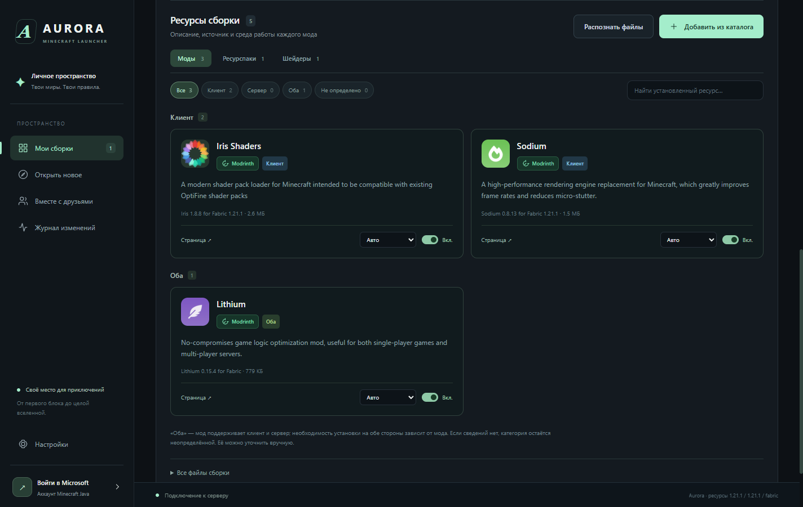

# Aurora

A desktop Minecraft Java launcher for Windows, with a shared modpack workspace for friends.

**Status: 0.2.0 preview.** This repository replaces the abandoned CraftSync implementation with Aurora. The repository address is retained; the previous implementation remains in Git history.



## What it does

- Manage separate Minecraft instances with Vanilla, Fabric, Quilt, Forge and NeoForge.
- Browse modpacks, mods, resource packs and shaders through Modrinth and the CurseForge integration.
- Inspect resource cards with descriptions, provider badges and client/server categories; disable mods or set a category manually.
- Install compatible resource versions and required dependencies, with checksums and file backups.
- Share one modpack through a self-hosted HTTPS workspace, with a master password, UUID-based editor permissions and revision history.
- Download the required Java runtime automatically. Packaged Windows builds include the desktop runtime.

## Integration status

**CurseForge access is not provisioned for Aurora yet.** Search and installation require a valid third-party platform API key. An author Upload API token is a different credential. The launcher reports unavailable downloads and does not circumvent authors' distribution restrictions. No Prism Launcher keys are included.

**Microsoft sign-in requires an approved application Client ID.** The launcher implements Microsoft → Xbox Live → Minecraft Services authentication; an account owning Minecraft Java Edition is required. Live sign-in and game launch have not been validated with an Aurora application ID. There is no offline account bypass.

Modrinth resource downloads have been tested live. CurseForge integration has been tested with controlled API responses, not a live Aurora key. See [validation](VALIDATION.md) for the exact scope.

## Build and run

On Windows x64, install Node.js 22 or newer, then:

```powershell
npm ci
npm test
npm start
npm run dist
```

The portable output is `dist/Aurora-0.2.0-Windows-x64.exe`. End users do not need Node.js or a separate Java installation. User data lives under `%APPDATA%/aurora-launcher`. The EXE is not digitally signed.

The **Windows build** GitHub Actions workflow can also produce an EXE artifact after a successful test run. No game files, mod binaries, API secrets or user profiles belong in this repository.

## Documentation

- [Руководство на русском](documentation/USER_GUIDE_RU.md)
- [Validation and current limitations](VALIDATION.md)
- [Integration overview for API reviewers](documentation/INTEGRATIONS.md)
- [Static project website](docs/index.html)
- [GitHub Pages setup](documentation/PUBLISHING.md)

Minecraft Java 1.18+ is the intended scope. Installed files still need testing in game; arbitrary mod combinations are not guaranteed to be compatible. Internet sharing requires a reachable host and appropriate network configuration.

## Contact and licensing

Maintainer: [ffxlino](https://github.com/ffxlino). Questions and bug reports: [repository issues](https://github.com/ffxlino/CraftSync/issues).

Aurora source code is licensed under [MIT](LICENSE). Third-party dependencies, Minecraft and mods retain their respective licenses. Aurora is independent and is not an official Minecraft product or affiliated with Mojang, Microsoft, CurseForge, Modrinth or Prism Launcher. This project does not bundle Prism source code or credentials.
