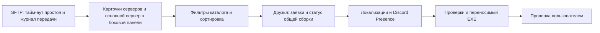

# Aurora 0.10 — серверы, каталог и общение

Публикация Aurora 0.10 разрешена пользователем 14 октября 2026 года.

| Работа | Статус | Результат |
|---|---|---|
| Исправление SFTP | Реализовано, тесты прошли | Считается время без данных, а не общая длительность чтения; ошибка указывает файл |
| Серверы | Реализовано | Список карточками, основной сервер, онлайн/игроки/задержка в боковой панели |
| Bisect API | Реализовано; пользователь создал ключ | Локальное зашифрованное поле; реальное подключение проверяется пользователем |
| Каталог | Реализовано | Популярность, скачивания, обновления, новые; категории из API и быстрые теги |
| Публикация | Проверка существующего решения | Один активный файл в одном Release на каждую отдельную сборку; история в журнале |
| Друзья | Реализовано; API развёрнут | Заявки и взаимное принятие; онлайн и публичная сборка; возможность скрыть статус |
| Локализация | Основной интерфейс готов | Русский/английский, сохранённый язык интерфейса |
| Discord Presence | Адаптер готов, проверен локально | Статус Aurora и активной сборки; отдельное включение; требуется Application ID Aurora |
| Arch | Отмечено | Общий код Windows/Linux; проверка Arch требует среды Linux |

Ответ на пункт 2 прежних предложений: после переезда на собственный хостинг лаунчер продолжит скачивать один актуальный архив по стабильному адресу. Новая версия сначала проверяется, затем заменяет прежнюю; незавершённая загрузка не должна ломать рабочую сборку. Это внутренняя организация хранения, пользователю не придётся вручную переносить файлы.

Дополнительные идеи: показ возраста последней успешной проверки; ограничение частоты запросов сервера; явная пометка устаревшего статуса при потере сети; диагностика недоступности серверов; избранный сервер и быстрый запуск связанной сборки; приватность статуса друзей; предварительный список очистки старых GitHub Release; впоследствии — совместные приглашения на сервер, экспорт безопасного отчёта диагностики, проверка свободного места до установки больших сборок.

Будущее: полноценный сайт Aurora и миграция хранения сборок; расширенная поддержка CurseForge после одобрения ключа; собственная телеметрия TPS при отсутствии доступа Starbase; база данных Bisect при необходимости для сайта. Для небольшого списка друзей уже есть хранилище Worker — подключение MySQL сейчас не требуется.

